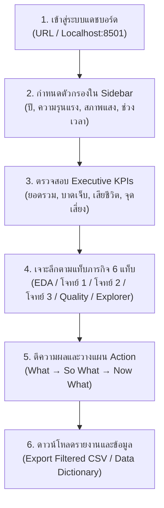

# คู่มือการใช้งานระบบและแนวคิดการวิเคราะห์ข้อมูล (Infographic User Manual)
## ระบบวิเคราะห์ข้อมูลอุบัติเหตุทางถนน (AI Road Crash Analytics Dashboard)
### การแข่งขันทักษะวิชาชีพ สาขาวิชาเทคโนโลยีปัญญาประดิษฐ์ ทักษะการวิเคราะห์ข้อมูล ระดับ ปวช.
### ระดับภาคตะวันออกเฉียงเหนือ ประจำปีการศึกษา 2568 - 2572

---

## 📌 1. ภาพรวมระบบและวัตถุประสงค์ (System Overview)

ระบบ **AI Road Crash Analytics Dashboard** พัฒนาขึ้นเพื่อเป็นเครื่องมือสนับสนุนการตัดสินใจเชิงนโยบาย (Data-Driven Decision Making) สำหรับวิศวกรรมความปลอดภัยทางถนนและเจ้าหน้าที่ผู้เกี่ยวข้อง โดยวิเคราะห์โทรมาตรอุบัติเหตุจริงกว่า **194,726 เรคคอร์ด (39 ฟิลด์)** ตั้งแต่ปี 2021 ถึง 2024 เพื่อตอบโจทย์ 3 มิติวิกฤต:
1. **พฤติกรรมเสี่ยงคนขับ (Driver Distraction)**
2. **ผลกระทบของสภาพแวดล้อมและเวลากลางคืน (Nighttime & Environmental Hazards)**
3. **จุดเสี่ยงนอกช่วงเร่งด่วน (Off-Peak Road Black Spots)**

---

## 🎨 2. โครงสร้างอินโฟกราฟิกแนะนำขั้นตอนการใช้งาน (Infographic Workflow)



---

## 🚀 3. คำแนะนำการใช้งานระบบเบื้องต้น (Quick Guide)

### 3.1 การเริ่มใช้งานระบบ (Getting Started)
1. เปิดเว็บบราวเซอร์ (Chrome / Edge / Firefox)
2. เข้าสู่ระบบผ่าน URL ที่คณะกรรมการจัดเตรียมไว้ หรือรันคำสั่งในเครื่อง:
   ```powershell
   streamlit run app.py
   ```
3. หน้าจอหลักจะแสดงผลแบบ Responsive เต็มจอ (Wide Layout) พร้อมโหลดข้อมูลผ่านหน่วยความจำแคช Parquet ภายใน 1–2 วินาที

### 3.2 การใช้งานแถบควบคุมตัวกรอง (Sidebar Controls)
* **📅 ปีที่เกิดเหตุ (Crash Year)**: เลือกปี 2021 – 2024 เพื่อดูแนวโน้มเปรียบเทียบ
* **⚠️ ระดับความรุนแรง (Severity)**: กรองดูเฉพาะ `Fatal Crash` (เสียชีวิต), `Injury Crash` (บาดเจ็บ), หรือ `Property Damage` (ทรัพย์สินเสียหาย)
* **🌙 สภาพแสง (Lighting Condition)**: สลับดูระหว่าง "เฉพาะกลางวัน" และ "เฉพาะกลางคืน/ที่มืด (Dark)"
* **⏰ ช่วงเวลาการเดินทาง**: เลือกดู "นอกช่วงเวลาเร่งด่วน 10:00 - 16:00 น." หรือ "ช่วงเวลาเร่งด่วน (Commute Peak)"
* **🔄 ปุ่มรีเซ็ตตัวกรอง**: กดปุ่มเพื่อคืนค่าเริ่มต้นทั้งหมดทันทีเมื่อต้องการเริ่มต้นสำรวจใหม่

---

## 📊 4. โครงสร้างเนื้อหา 6 แท็บการวิเคราะห์ (Tab Navigation Guide)

### แท็บที่ 1: 📊 ภาพรวมสถิติ & EDA (Overview & Distribution)
* **กราฟเส้นแนวโน้มรายเดือน**: สังเกตความแปรผันตามฤดูกาลและยอดรวมสะสม
* **Donut Chart สัดส่วนความรุนแรง**: ทราบสัดส่วนอุบัติเหตุรุนแรง (กว่า 32% เกิดการบาดเจ็บหรือเสียชีวิต)
* **Heatmap Matrix (วัน vs ชั่วโมง)**: จุดเสี่ยงสูงสุดช่วงเย็นวันธรรมดา (16:00-18:00) และดึกวันหยุด

### แท็บที่ 2: 📱 โจทย์ 1 - พฤติกรรมเสี่ยงคนขับ (Driver Distraction)
* **กราฟแท่งแนวนอนจัดอันดับพฤติกรรม**: พฤติกรรมละสายตาและใช้อุปกรณ์อิเล็กทรอนิกส์ที่มีอัตราการบาดเจ็บ/เสียชีวิตสูงสุด
* **Scatter Plot**: เปรียบเทียบระหว่างความถี่ที่เกิดเหตุ vs ระดับความอันตรายจริง

### แท็บที่ 3: 🌙 โจทย์ 2 - สภาพแวดล้อม & กลางคืน (Nighttime Hazards)
* **เปรียบเทียบกลางวัน vs กลางคืน**: อัตราการเสียชีวิตในเวลากลางคืนสูงกว่ากลางวันถึง +45%
* **ผลกระทบของสภาพถนนเปียกลื่น**: การพุ่งชนต้นไม้/ตกข้างทาง (Single Vehicle) พุ่งสูงในสภาวะถนนเปียกในที่มืด

### แท็บที่ 4: 📍 โจทย์ 3 - จุดเสี่ยงนอกเวลาเร่งด่วน (Off-Peak Hotspots)
* **10 อันดับถนนอันตรายนอกช่วงเร่งด่วน**: ระบุชื่อถนนที่เกิดเหตุสูงสุดช่วง 10:00 - 16:00 น.
* **ความสัมพันธ์กับป้าย/สัญญาณควบคุม**: กว่า 45% เกิดบริเวณทางแยกสัญญาณไฟหรือจุดที่ไม่มีการควบคุม
* **Geospatial Density Map**: แผนที่พิกัดดาวเทียมแสดงจุดเกิดเหตุหนาแน่น

### แท็บที่ 5: 🛡️ คุณภาพข้อมูล & Dictionary (Data Quality Assurance)
* ตรวจสอบความสมบูรณ์ของ Primary Key (`Report Number` 100% Unique)
* ตารางเปรียบเทียบก่อน-หลังการจัดการ Missing Values และ Outliers
* ค้นหาคำนิยามใน **Data Dictionary** และดาวน์โหลดเป็นไฟล์ CSV

### แท็บที่ 6: 🔍 สำรวจข้อมูล & ส่งออก (Data Explorer & Export)
* ค้นหาเจาะจงรายหมายเลขรายงาน หรือชื่อถนน
* ปรับเลือกคอลัมน์ที่ต้องการแสดงผล
* ปุ่มดาวน์โหลดข้อมูลที่ผ่านการกรอง (Export Filtered CSV) ไปใช้งานต่อ

---

## 💡 5. การตีความผลลัพธ์: กรอบ "What → So What → Now What"

ใต้กราฟและตารางการวิเคราะห์ทุกส่วนในแดชบอร์ด จะมีกรอบสรุปการตีความผล 3 ขั้นตอน:
1. **What (ภาพบอกอะไร)**: ตัวเลขสถิติ แนวโน้ม หรือความแตกต่างที่สังเกตได้จากข้อมูลจริง
2. **So What (ความหมายต่อบริบท)**: ผลกระทบเชิงวิศวกรรมความปลอดภัย และสาเหตุเชิงลึก
3. **Now What (ข้อเสนอการตัดสินใจ)**: มาตรการเชิงนโยบาย ข้อแนะนำปรับปรุงป้ายสัญญาณ หรือมาตรการบังคับใช้กฎหมายที่นำไปปฏิบัติได้จริงทันที

---

## 🛠️ 6. การจัดการข้อผิดพลาดและกรณีไม่พบข้อมูล (Empty-State Handling)

* หากท่านเลือกฟิลเตอร์ที่มีเงื่อนไขทับซ้อนจนไม่พบข้อมูล (0 เรคคอร์ด) ระบบจะแสดงกล่องเตือนสีส้มอย่างชัดเจน:
  > **⚠️ ไม่พบข้อมูลตามเงื่อนไขตัวกรองที่คุณเลือก**
* พร้อมปุ่ม **"กดที่นี่เพื่อรีเซ็ตตัวกรอง"** ที่กลางหน้าจอ เพื่อให้สามารถย้อนกลับสู่สถานะปกติได้ในคลิกเดียว
