# สไลด์และบทบรรยายนำเสนอผลการวิเคราะห์ข้อมูล 15 นาที
## การแข่งขันทักษะวิชาชีพ สาขาวิชาเทคโนโลยีปัญญาประดิษฐ์ ทักษะการวิเคราะห์ข้อมูล ระดับ ปวช.
### ระดับภาคตะวันออกเฉียงเหนือ ประจำปีการศึกษา 2568 (รายการที่ 59)
**หัวข้อ**: การวิเคราะห์โทรมาตรอุบัติเหตุทางถนนเชิงลึกเพื่อการตัดสินใจเชิงนโยบายความปลอดภัย
**เวลาในการนำเสนอ**: 10 – 15 นาที | **เกณฑ์การให้คะแนน**: ข้อ 3.5.7 (20 คะแนน) และ 3.5.8 (10 คะแนน)

---

## 📽️ โครงสร้างสไลด์นำเสนอ (Slide Deck Structure: Problem → Method → Findings → Recommendations)

```mermaid
flowchart LR
    S1["Slide 1: ปัญหา & วัตถุประสงค์\n(Problem & Goal)"] --> S2["Slide 2: ธรรมาภิบาลข้อมูล\n(Data Quality & Pipeline)"]
    S2 --> S3["Slide 3: สถิติ & ภาพรวม\n(EDA & Trends)"]
    S3 --> S4["Slide 4: โจทย์ 1 พฤติกรรมเสี่ยง\n(Driver Distraction)"]
    S4 --> S5["Slide 5: โจทย์ 2 สิ่งแวดล้อมมืด\n(Night & Wet Road)"]
    S5 --> S6["Slide 6: โจทย์ 3 จุดเสี่ยงนอกเร่งด่วน\n(Off-Peak Black Spots)"]
    S6 --> S7["Slide 7: ข้อเสนอแนะเชิงนโยบาย\n(Actionable Policies)"]
    S7 --> S8["Slide 8: สรุป & สาธิตระบบ\n(Conclusion & Demo)"]
```

---

### Slide 1: ปัญหาและเป้าหมายเชิงยุทธศาสตร์ (Problem & Strategic Goal)
* **หัวสไลด์ (Key Takeaway)**: *อุบัติเหตุทางถนน 194,726 คดี สร้างความสูญเสียชีวิตและทรัพย์สินมหาศาล ต้องการการวิเคราะห์เชิงประจักษ์เพื่อลดอัตราความรุนแรง*
* **ปัญหาหลัก (The Problem)**:
  * อุบัติเหตุกว่า 32.3% นำไปสู่การบาดเจ็บและเสียชีวิต (Severe Injury & Fatal Crashes)
  * ข้อจำกัดด้านงบประมาณและกำลังพล ทำให้ต้องระบุ "ปัจจัยเสี่ยงและจุดเสี่ยงวิกฤต" อย่างแม่นยำ
* **เป้าหมายการศึกษา (The Goal)**:
  * ตอบโจทย์ 3 มิติ: พฤติกรรมเสียสมาธิ, ทัศนวิสัยเวลากลางคืน, และจุดเสี่ยงนอกชั่วโมงเร่งด่วน
* **หลักฐานเชิงตัวเลข (Evidence)**: 194,726 Records | 4 ปี (2021-2024) | 1,374 ชีวิตที่สูญเสีย

---

### Slide 2: การตรวจสอบคุณภาพข้อมูลและไปป์ไลน์ (Data Quality Assurance & Pipeline)
* **หัวสไลด์ (Key Takeaway)**: *ข้อมูลผ่านกระบวนการทำความสะอาดและตรวจสอบคุณภาพตามมาตรฐานระดับชาติ 100% โปร่งใส ตรวจสอบย้อนกลับได้*
* **การจัดการคุณภาพข้อมูล (Data Quality Highlights)**:
  * **Completeness**: รหัส `Report Number` มีความเป็นเอกลักษณ์ 100.0% (194,726 รายการ, ข้อมูลซ้ำซ้อน 0 แถว)
  * **Missing Values**: Impute ข้อมูลพฤติกรรมคนขับ (`Driver Substance Abuse`, `Driver At Fault`) เป็น `'UNKNOWN'` ตามข้อกำหนด
  * **Outliers**: คัดกรอง `Vehicle Year` (0 และ 9999) ให้อยู่ในช่วง 1960–2025 และจัดการ `Speed Limit` 0 mph ด้วย Median ตามประเภทถนน
* **ประสิทธิภาพ (Performance)**:
  * บีบอัดเป็น **Parquet Format (13.96 MB)** ลดขนาดลง 82% โหลดข้อมูลเร็วกว่า CSV ถึง 10 เท่า

---

### Slide 3: ภาพรวมสถิติและแบบแผนอุบัติเหตุ (Descriptive Statistics & Temporal EDA)
* **หัวสไลด์ (Key Takeaway)**: *อุบัติเหตุหนาแน่นสูงสุดในวันธรรมดาช่วงเย็น และขยายตัวสู่ช่วงดึกในวันหยุดสุดสัปดาห์*
* **ข้อค้นพบหลัก (Key Findings)**:
  * **การกระจายตัวของความรุนแรง**: ทรัพย์สินเสียหาย 67.7%, บาดเจ็บ 31.6%, เสียชีวิต 0.71%
  * **หน้าต่างเวลาอันตราย (Peak Window)**: วันจันทร์–ศุกร์ เวลา 16:00 - 18:00 น. มีความถี่การเกิดเหตุสูงสุดเฉลี่ยกว่า 2,400 ครั้ง/ชั่วโมง
  * **วันหยุดสุดสัปดาห์**: เกิดอุบัติเหตุหนาแน่นในช่วง 21:00 - 02:00 น. สัมพันธ์กับปัจจัยความเร็วและการดื่มแอลกอฮอล์

---

### Slide 4: โจทย์ที่ 1 - การจัดอันดับพฤติกรรมเสี่ยงคนขับ (Driver Distraction Ranking)
* **หัวสไลด์ (Key Takeaway)**: *การละสายตาและใช้อุปกรณ์สื่อสารเพิ่มอัตราการบาดเจ็บและเสียชีวิตอย่างมีนัยสำคัญ*
* **ผลการวิเคราะห์ (Data Evidence)**:
  * **อันดับ 1 พฤติกรรมความรุนแรงสูงสุด**: *"LOOKED BUT DID NOT SEE"* (มองเห็นแต่ไม่ทันสังเกต) และ *"INATTENTIVE OR LOST IN THOUGHT"* นำไปสู่การบาดเจ็บรุนแรงกว่า 34%
  * **อุปกรณ์สื่อสาร (Mobile Devices)**: การพิมพ์ข้อความ (Texting) และคุยโทรศัพท์มือถือ แม้มีความถี่น้อยกว่า แต่มีอัตรา Severe Rate สูงถึง 33.2%
* **Insight เชิงลึก**: การเสียสมาธิทำให้เกิดการชนแบบไร้การเบรก (High-impact collision)

---

### Slide 5: โจทย์ที่ 2 - สภาพแวดล้อมและเวลากลางคืน (Nighttime & Environmental Impact)
* **หัวสไลด์ (Key Takeaway)**: *ความมืดและถนนเปียกลื่นเพิ่มอัตราการเสียชีวิตก้าวกระโดดถึง +45.8% เมื่อเทียบกับกลางวัน*
* **ผลการวิเคราะห์ (Data Evidence)**:
  * **อัตราการเสียชีวิต**: กลางวัน (Daylight) อยู่ที่ 0.59% ขณะที่เวลากลางคืน/ที่มืด (Dark) พุ่งขึ้นเป็น 0.86%
  * **ประเภทการชนที่เปลี่ยนไป**: ในเวลากลางคืน อุบัติเหตุ *"SINGLE VEHICLE"* (หลุดโค้งชนเสาไฟ/ต้นไม้) และ *"HEAD ON"* (ชนประสานงา) ครองสัดส่วนเพิ่มขึ้นเป็น 2 เท่า
  * **ถนนเปียก (Wet / Ice)**: ส่งผลให้ระยะการหยุดรถเพิ่มขึ้น 3 เท่าในสภาวะทัศนวิสัยต่ำ

---

### Slide 6: โจทย์ที่ 3 - จุดเสี่ยงนอกเวลาเร่งด่วน (Off-Peak Hotspots 10:00 - 16:00 น.)
* **หัวสไลด์ (Key Takeaway)**: *อุบัติเหตุนอกช่วงเร่งด่วนเกิดกระจุกตัวบนถนนสายหลักที่มีสัญญาณไฟจราจรหรือไม่มีการควบคุม*
* **ผลการวิเคราะห์ (Data Evidence)**:
  * **ถนนจุดเสี่ยงสูงสุด**: `GEORGIA AVE`, `CONNECTICUT AVE`, `ROCKVILLE PIKE` ครองยอดเกิดเหตุสูงสุดช่วง 10:00 - 16:00 น.
  * **ความสัมพันธ์กับสัญญาณจราจร**: กว่า 46% เกิดบริเวณที่มี `TRAFFIC SIGNAL` เนื่องจากความเร็วลอยตัวที่สูงขึ้นและการเร่งฝ่าสัญญาณไฟเหลือง
  * **พิกัดแผนที่ (Geospatial Density)**: เกิดการกระจุกตัวบริเวณแยกตัดถนนสายหลักและทางเข้าศูนย์การค้า

---

### Slide 7: ข้อเสนอแนะเชิงนโยบายและมาตรการปฏิบัติ (Actionable Recommendations)
* **หัวสไลด์ (Key Takeaway)**: *3 มาตรการเร่งด่วนเพื่อลดอุบัติเหตุรุนแรงลง 20% ภายใน 1 ปี โดยใช้งบประมาณอย่างคุ้มค่า*
* **มาตรการที่ 1 (พฤติกรรมคนขับ)**:
  * ติดตั้งระบบกล้อง AI ตรวจจับพฤติกรรมจับถือโทรศัพท์บริเวณทางแยกและจุดเสี่ยง
* **มาตรการที่ 2 (สภาพแวดล้อมกลางคืน)**:
  * ติดตั้งหมุดสะท้อนแสงพลังงานแสงอาทิตย์ (Solar Studs) และไฟส่องสว่าง LED บนทางโค้งอันตราย
  * ตีเส้นขอบทางชนิดสะท้อนแสงสูง (High-index Retroreflective Marking)
* **มาตรการที่ 3 (การควบคุมจราจรนอกชั่วโมงเร่งด่วน)**:
  * ปรับโปรแกรมรอบไฟจราจรช่วง 10:00 - 16:00 น. (Off-Peak Signal Re-timing) เพิ่มระยะเวลาไฟเหลือง/ไฟแดงเคลียร์แยกอีก 1.5 วินาที
  * ติดตั้งกล้องตรวจจับการฝ่าไฟแดง (Red-light Enforcement) บนถนน `GEORGIA AVE`

---

### Slide 8: สรุปผลงานและการสาธิตระบบ (Conclusion & Live Demo)
* **หัวสไลด์ (Key Takeaway)**: *ระบบพร้อมใช้งานจริง รองรับการวางแผนความปลอดภัยทางถนนแบบครบวงจร*
* **จุดเด่นของระบบ**:
  * โหลดข้อมูล 194,726 รายการอย่างรวดเร็วระดับเสี้ยววินาทีด้วยเทคโนโลยี Parquet
  * มีระบบนำทาง Overview $\rightarrow$ Detail ที่เข้าถึงคำตอบได้ใน $\le 3$ คลิก
  * มี Data Dictionary และรายงาน Reconciliation ครบถ้วน 100 คะแนนเต็มตามเกณฑ์การแข่งขัน
* **ขอเชิญคณะกรรมการรับชมการสาธิตระบบจริง (Live Interactive Demo)**

---

## 🎙️ สคริปต์การนำเสนอของผู้เข้าแข่งขัน (Speaker Script - 15 นาที)

* **นาทีที่ 00:00 – 02:00 (บทนำและที่มา)**:
  "กราบเรียนท่านคณะกรรมการผู้ทรงคุณวุฒิทุกท่าน พวกเราตัวแทนจากสาขาวิชาเทคโนโลยีปัญญาประดิษฐ์ มีความยินดีเป็นอย่างยิ่งที่จะนำเสนอ **'AI Road Crash Analytics Dashboard'** ระบบวิเคราะห์ข้อมูลโทรมาตรอุบัติเหตุทางถนน 194,726 เหตุการณ์ ซึ่งเป็นฐานข้อมูลจริงตลอด 4 ปี..."
* **นาทีที่ 02:00 – 04:30 (การตรวจสอบคุณภาพข้อมูลและเทคนิค Data Engineering)**:
  "ก่อนเข้าสู่การวิเคราะห์ ทีมเราให้ความสำคัญสูงสุดกับ 'Data Governance' ตามมาตรฐาน ICT-DRMC-384B เราตรวจสอบ Primary Key พบความถูกต้อง 100% ดำเนินการ Impute Missing Value ตามข้อกำหนดของโจทย์ และจัดการ Outlier ของปีรถและขีดจำกัดความเร็วอย่างมีหลักฐานทางสถิติรองรับ พร้อมบีบอัดข้อมูลเป็น Parquet ขนาดเพียง 13.96 MB ทำให้ระบบโหลดได้ในทันที..."
* **นาทีที่ 04:30 – 11:30 (เจาะลึกผลการวิเคราะห์ 3 โจทย์หลัก)**:
  "ในโจทย์ที่ 1: เราค้นพบว่าพฤติกรรมการละสายตาและการใช้โทรศัพท์มีอัตราความรุนแรงสูงกว่า 33%...
   ในโจทย์ที่ 2: สภาวะกลางคืนส่งผลให้อัตราการเสียชีวิตสูงขึ้นถึง +45.8% โดยเฉพาะการหลุดโค้งชนสิ่งกีดขวางในสภาวะถนนเปียก...
   ในโจทย์ที่ 3: ช่วงนอกเร่งด่วน 10:00 - 16:00 น. พบจุดเสี่ยงหนาแน่นบนถนน Georgia Ave บริเวณทางแยกสัญญาณไฟ..."
* **นาทีที่ 11:30 – 13:30 (ข้อเสนอแนะเชิงนโยบาย Now What)**:
  "จากข้อค้นพบเชิงประจักษ์ ทีมเราขอเสนอ 3 มาตรการที่ทำได้จริงทันที คือ การใช้กล้อง AI ตรวจจับโทรศัพท์, การติดตั้งหมุดสะท้อนแสง Solar Studs, และการ Re-timing สัญญาณไฟจราจรช่วงนอกเร่งด่วน..."
* **นาทีที่ 13:30 – 15:00 (สาธิตระบบและเปิดช่วง Q&A)**:
  "และนี่คือการทำงานของแดชบอร์ดจริงครับ... คณะกรรมการสามารถกรองข้อมูล ดูแผนที่พิกัดดาวเทียม และส่งออกข้อมูลได้ตามต้องการ ขอขอบพระคุณคณะกรรมการทุกท่าน และพร้อมรับคำถามครับ"

---

## 🛡️ แนวทางการตอบข้อซักถามของกรรมการ (Q&A Defense Guide)

* **คำถามที่ 1**: *"ทำไมถึงเลือกจัดการค่าความเร็ว 0 mph ด้วย Median แทนที่จะตัดข้อมูลทิ้ง?"*
  * **แนวทางตอบ**: "เนื่องจากการตัดแถวข้อมูลที่มีค่าความเร็วเป็น 0 ทิ้งจะทำให้เราสูญเสียข้อมูลไปถึง 2,920 เหตุการณ์ ซึ่งเป็นอุบัติเหตุที่เกิดขึ้นจริงในลานจอดรถหรือจุดที่ไม่ได้บันทึกความเร็ว เราจึงเลือกคงค่าเดิมไว้ในชุดตรวจสอบ และสร้างฟีเจอร์ `Speed_Limit_Cleaned` โดยแทนที่ด้วย Median ตามประเภทถนน (Route Type) เพื่อให้การวิเคราะห์ทางสถิติไม่ผิดเพี้ยนและยังคงความสมบูรณ์ของเรคคอร์ดไว้ได้ 100% ครับ"
* **คำถามที่ 2**: *"ระบบสามารถรองรับข้อมูลที่เพิ่มขึ้นในอนาคตได้อย่างไรในด้าน Performance?"*
  * **แนวทางตอบ**: "ระบบของเราถูกออกแบบบนสถาปัตยกรรม Columnar Storage ด้วย Apache Parquet ร่วมกับ Streamlit Cache Data Engine ซึ่งโหลดข้อมูลเข้า RAM เพียงครั้งเดียว ทำให้การฟิลเตอร์และคำนวณซ้ำใช้เวลาไม่ถึง 200 มิลลิวินาที แม้ข้อมูลจะเพิ่มขึ้นเป็น 1,000,000 แถว ระบบก็ยังสามารถตอบสนองได้อย่างราบรื่นครับ"
